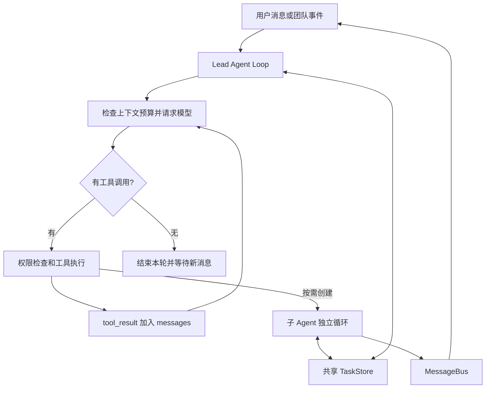

# Multi-Agent Team Framework

**简体中文** | [English](README.en.md)

一个便于阅读、修改和实验的 Python 多 Agent 框架，沿用 learn-claude-code 风格的 Agent Loop。**全部实现放在带详细中文注释的 `main.py` 中**，通过 16 个可折叠分区区分模块。

用户提出目标，Lead 可以直接使用工具完成工作，也可以按需创建子 Agent，自行决定人数、名字和职责。没有预设岗位，也不需要团队配置 JSON。

## 已实现的能力

- **动态组队**：子 Agent 在独立线程中运行，各自拥有消息历史与模型循环。
- **共享任务板**：创建任务、建立依赖、派发、认领和完成，使用文件锁协调状态。
- **消息协作**：MessageBus 使用 JSONL 邮箱与线程通知传递任务反馈、审批和关闭请求。
- **工具执行**：文件读写、Shell、任务与团队操作；子 Agent 可进一步限制工作区工具。
- **上下文压缩**：请求前估算预算，缩短旧工具结果，必要时生成滚动摘要。
- **协作控制**：可选计划审批、Git worktree、产物及可选质量报告检查。

持久 Memory 和 MCP 尚未实现。当前模型客户端使用 DeepSeek，通过 Anthropic SDK 调用兼容消息接口。

## 快速开始

需要 Python 3.10+，以及可用的 DeepSeek API 密钥和额度。先激活你自己选择的 Python 环境；项目不会指定解释器路径或自动切换环境。

下面使用 Windows PowerShell：

```powershell
git clone https://github.com/hihihiddssa/multi-agent-team-framework.git
cd multi-agent-team-framework
python -m pip install -r requirements.txt
Copy-Item .env.example .env
```

在本地 `.env` 中填写密钥和模型：

```dotenv
DEEPSEEK_API_KEY=your_deepseek_api_key
MODEL_ID=deepseek-flash
```

```powershell
# 填写环境变量后检查启动参数，不发送 API 请求
python main.py --check-config

# 启动交互；输入 q / exit 或 Ctrl+C 退出
python main.py

# 为新任务使用独立产物目录
python main.py --workdir workspace/counter-demo
```

实际模型请求发往 `https://api.deepseek.com/anthropic`。`--check-api` 会访问模型列表验证接口；不会生成文本。真实 `.env`、运行产物和缓存均被 Git 忽略。

在 VS Code 中，通过 **Python: Select Interpreter** 选择已安装依赖的环境。可运行 `python -c "import sys; print(sys.executable)"` 确认终端解释器；`.env` 与 Python 虚拟环境是两回事。

## 运行流程



同一条模型回复中的工具调用目前按顺序执行；子 Agent 线程可以并发工作。结束一轮回复不会退出程序或关闭子 Agent。

需要跟踪委派任务时，通常使用：

```text
create_task → 必要的 update_task 依赖
            → assign_task(task_id, 自选成员名)
            → spawn_teammate(name, role, prompt, task_id)
```

创建时会自动认领已派发、依赖就绪的初始任务，不需要子 Agent 重复 claim。依赖未就绪时省略 spawn 的 `task_id`，成员空闲后会自动领取派发给自己的就绪任务。子 Agent 使用文件和 Shell 工具前必须认领任务。

`complete_task` 只更新任务状态，随后仍会进入模型循环处理结果；成员最终报告结果后进入空闲状态，等待消息或新任务。Lead 通过 `request_shutdown` 请求它退出。

## 工具与阅读入口

| 对象 | 用途 |
| --- | --- |
| `BASE_TOOLS` | `bash`、`read_file`、`write_file`、`edit_file`、`glob` |
| `TASK_TOOLS` | 创建、依赖、列表、详情、认领、完成与派发任务 |
| `TEAM_TOOLS` | 动态创建成员、成员列表、消息、计划审批、关闭和 worktree |
| `DELIVERY_TOOLS` | `accept_delivery` 检查产物、已有任务和可选质量报告 |
| `TOOLS` | 上述四组定义合并后的 Lead 工具集合，传给模型 |
| `TOOL_HANDLERS` | 工具名到 Python 执行函数的映射 |
| `TEAMMATE_TOOLS` | 子 Agent 专用集合，额外包含 `submit_plan`，再按成员权限筛选 |

子 Agent 不具备创建成员、创建任务或验收交付的工具。`TEAMMATE_TOOLS` 复用了部分 Lead 工具定义，因此不会再次拼入 `TOOLS`。

建议阅读顺序：`main()` → `agent_loop()` → `execute_tool()` → `TOOL_HANDLERS` → `run_*()`；然后阅读 `TeammateRuntime.work()` 和 `spawn_teammate_thread()`。

常用分区：04 提示词与设置、05 任务板、08 消息与协议、10 工具实现、11 子 Agent 生命周期、12 工具定义与分发、15 Lead 循环。文件顶部有完整目录，VS Code 支持折叠 `# region`。与原教学代码的对应关系见 [SOURCE_MAP.md](SOURCE_MAP.md)。

## 修改行为与权限

直接编辑 `main.py` 第 04 节，重启后生效：

| 设置 | 作用 |
| --- | --- |
| `TEAM_NAME` | 显示名称 |
| `LEAD_PROMPT` | Lead 的行为、范围与分工原则 |
| `TEAMMATE_PROMPT` | 子 Agent 共用约束；具体职责来自创建时的 role/prompt |
| `TEAMMATE_ALLOWED_TOOLS` | 子 Agent 工作区工具权限上限 |
| `DELIVERY_REQUIRED_FILES` | 必需产物列表，默认 `[]` |
| `QUALITY_REPORT_PATH` | 可选质量报告路径，默认 `None` |

创建子 Agent 时的 `tools` 参数只能进一步缩小权限，不能越过上限。`tools=[]` 仍保留任务、消息和计划工具；Lead 工具不受该上限限制。名字、职责和人数由模型决定，默认提示词要求简单任务直接完成、只做最小必要工作。

`accept_delivery` 至少需要一个真实产物文件，不要求创建子 Agent 或任务；若有任务，必须全部完成。启用质量报告时，报告须引用实际执行者拥有且完成的任务，并包含 `passed: true`、空 `issues` 和成功命令的 `checks`。执行者可以是 Lead 或动态成员。

## 上下文与 Token

在 `.env` 中修改，默认值如下：

| 变量 | 默认值 |
| --- | --- |
| `AGENT_MAX_OUTPUT_TOKENS` | `4096` |
| `CONTEXT_COMPRESSION_ENABLED` | `true` |
| `CONTEXT_MAX_TOKENS` | `48000` |
| `CONTEXT_TRIGGER_RATIO` | `0.8` |
| `CONTEXT_TARGET_RATIO` | `0.55` |
| `CONTEXT_KEEP_RECENT` | `8` |
| `CONTEXT_KEEP_TOOL_RESULTS` | `3` |
| `CONTEXT_SUMMARY_TOKENS` | `2000` |
| `CONTEXT_TOOL_RESULT_CHARS` | `2400` |

预算包含 system、工具定义、历史、回复预留与协议余量，按 UTF-8 字节估算，不是服务端精确 Token 数。先缩短旧工具输出，再按需请求模型生成摘要；保留近期消息及完整工具调用/结果配对。摘要只属于各 Agent 当前进程，失败时不替换原历史。

终端会打印每次模型请求的耗时、输入、缓存读取和输出用量。压缩控制的是单次请求的历史大小，**不是整个任务的 Token 或请求次数硬上限**；摘要本身也会消耗 API 额度。

## 小规模协作测试

启动后发送：

> 请创建两个子 Agent 协作，在当前工作区的 collab-test/ 中制作一个单文件 index.html 计数器页面，支持加一、减一和重置；一人实现、一人独立检查，通过任务工具设置依赖并派发任务，检查结果用 send_message 告知 Lead，通过后验收交付并关闭成员，全程不安装依赖、不新增文档或测试框架、不轮询状态，最后简短汇报文件位置和实际检查结果。

路径相对于当前工作区。没有实际打开浏览器时，不应声称做过浏览器测试。

## 文件、限制与后续计划

```text
main.py          # 全部实现和16个可折叠分区，保留详细中文注释
README.md        # 中文说明
README.en.md     # English documentation
SOURCE_MAP.md    # 教学代码对应关系
.env.example     # 环境变量模板
workspace/       # 按需创建，不上传 Git
  .tasks/        # JSON 任务记录
  .mailboxes/    # JSONL 邮箱
  delivery.json  # 交付记录
```

- 工作目录不是 OS 沙箱；允许 Shell 就可以启动其他命令。Windows 的 `bash` 工具实际运行 CMD 语法。
- 任务与邮箱落盘；聊天历史、摘要和成员线程不会在重启后自动恢复。新任务建议使用独立工作区。
- 交付检查验证文件和报告结构，不证明报告中的命令实际执行过，也不保证产物质量。
- 持久 Memory、MCP 和任务级请求/Token 硬预算尚未实现。

## 来源与许可

改编自 **learn-claude-code s13** 的工具循环与团队结构，压缩思路参考 s08；保留原项目 MIT 许可和版权声明，详见 [LICENSE](LICENSE)。
