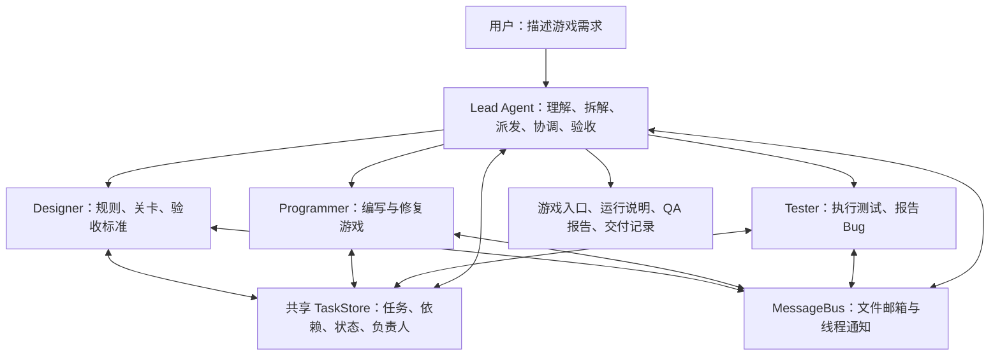

# Game Company Agent

一个用 Python 编写的游戏开发多 Agent 团队原型。用户描述想做的游戏，Lead Agent 负责理解需求、拆解任务、组织团队与检查交付，三个子 Agent 分别负责游戏设计、代码实现和测试反馈。

项目沿用 **learn-claude-code s13** 的 Agent Loop 思路，核心代码集中在一个带注释的 [`main.py`](main.py) 中，方便阅读、理解和逐步扩展。当前通过 DeepSeek API 调用模型。

> 当前是可运行的基础架构原型。上下文压缩、持久 Memory 和 MCP 尚未实现；游戏交付质量仍取决于模型、任务复杂度和实际测试环境。

## 团队如何工作



| Agent | 职责 |
| --- | --- |
| Lead | 理解需求，创建任务和依赖，派发工作，协调反馈，检查验收条件 |
| `designer` | 设计游戏规则、关卡和验收标准，输出设计文档 |
| `programmer` | 按设计编写、运行和修复游戏，提供启动方式 |
| `tester` | 执行检查，记录 Bug、复现步骤与结果，将问题反馈给团队 |

Lead 和队友分别维护自己的消息历史。队友在独立线程中持续运行，可以在空闲时等待消息或认领已就绪的任务。每个 Agent 都使用相同的基本循环：

```text
用户需求或团队事件
  → client.messages.create(...)
  → 提取 tool_use
  → 执行 Python 工具
  → 将 tool_result 放回消息历史
  → 继续调用模型，直到结束本轮工作
```

任务先创建、建立依赖，再由 Lead 派发。子 Agent 只能认领派给自己且前置依赖已完成的任务。任务记录保存在文件中，通过线程锁和文件锁保护；团队消息使用 JSONL 邮箱存储，读取后消费。

## 已实现

- 单文件 Agent Loop，以及 Lead 与三个固定职责的队友。
- 共享文件任务板：依赖、派发、认领、完成和工作目录绑定。
- MessageBus：成员间通信、消息等待与 Lead 事件唤醒。
- 文件读取、写入、编辑、搜索和 Shell 执行工具。
- Hooks、计划审批、队友关闭协议与可选 Git worktree。
- 交付检查：游戏入口、任务状态与 QA 报告。
- Windows 终端输入、中文输出，以及 Shell 执行进度和超时处理。

## 快速开始

### 1. 准备环境

需要 **Python 3.10+**、Git，以及可调用所选模型的 DeepSeek API 密钥和额度。下面以 Windows PowerShell 为例：

```powershell
git clone https://github.com/hihihiddssa/game-company-agent.git
cd game-company-agent

python -m venv .venv
.\.venv\Scripts\python.exe -m pip install -r requirements.txt
Copy-Item .env.example .env
```

编辑 `.env`，填写自己的密钥：

```dotenv
DEEPSEEK_API_KEY=your_deepseek_api_key
MODEL_ID=deepseek-flash
```

当前客户端使用 DeepSeek 官方的 Anthropic 兼容接口，地址为 `https://api.deepseek.com/anthropic`，并关闭深度思考。`anthropic` 是请求使用的 SDK，实际调用和计费由 DeepSeek 提供。

真实 `.env` 已被 Git 忽略；不要把自己的密钥写进源码或提交到仓库。

### 2. 检查配置并启动

```powershell
# 只检查配置，不联网
.\.venv\Scripts\python.exe main.py --check-config

# 读取模型列表，检查密钥和模型访问权限，不生成文本
.\.venv\Scripts\python.exe main.py --check-api

# 启动交互式工作室
.\.venv\Scripts\python.exe main.py
```

出现 `studio >>` 后输入需求，例如：

```text
做一个浏览器版贪吃蛇游戏，方向键控制，包含计分、失败提示和重新开始。
请先设计玩法，再实现代码并测试，最后给出游戏入口和运行方法。
```

输入 `q` 或 `exit` 退出，也可以按 `Ctrl+C`。退出时程序会请求队友关闭；仍在进行的模型或工具调用可能无法立即结束。

可以把第一条需求作为命令行参数传入，或为新游戏指定独立的工作目录：

```powershell
.\.venv\Scripts\python.exe main.py "制作一个简单的打砖块游戏"
.\.venv\Scripts\python.exe main.py --workdir workspace\snake
```

游戏所需的 Node.js、浏览器或其他运行依赖，由具体任务决定，不包含在 Python 依赖中。框架不会预先固定游戏模板或游戏引擎。

### 本机快捷启动脚本

仓库中的 `run.ps1` 和 `.vscode` 配置目前保留开发时使用的解释器路径：`D:\project\learn-claude-code\.venv\Scripts\python.exe`。

首次克隆时，建议使用上面的 `.venv` 命令运行。如果要使用 `run.ps1` 或 VS Code 的运行按钮，请将脚本中的 `$studioPython` 和编辑器解释器设置改为自己的 Python 路径。

## 目录说明

```text
game-company-agent/
├── main.py              # 核心程序：模型客户端、任务、消息、工具、团队和主循环
├── requirements.txt     # Python 依赖
├── .env.example         # 配置模板，不含真实密钥
├── .gitignore
├── run.ps1              # 本机 PowerShell 启动脚本
├── .vscode/             # 本机编辑器配置
├── SOURCE_MAP.md        # 与原教学代码的对应关系
├── LICENSE
└── workspace/           # 运行时按需创建，不上传到 Git
    ├── .tasks/          # 共享任务记录
    ├── .mailboxes/      # JSONL 邮箱
    ├── design/          # 游戏设计文档
    ├── game/            # 游戏代码与运行说明
    ├── tests/           # tester 为具体游戏生成的检查脚本
    ├── reports/qa.json  # 测试报告
    └── delivery.json    # Lead 验收通过后生成的交付记录
```

源码中的各项路径约定不代表目录在启动时全部创建；Agent 使用相关工具后才会按需生成文件。可选 worktree 功能还会使用 `.worktrees/`。本地归档测试产物的 `test/` 同样不上传。

`workspace/tests/` 属于生成游戏的测试产物，仓库不附带独立的框架测试目录。

## 如何阅读和扩展代码

建议按这个顺序阅读 [`main.py`](main.py)：

1. `main()`：配置加载、用户输入、团队事件与退出流程。
2. `agent_loop()`：Lead 在模型回复和工具调用之间循环。
3. `TOOLS`、`TOOL_HANDLERS`、`execute_tool()`：工具声明与实际执行函数。
4. `Task` 及任务函数：共享任务状态、依赖与角色派发。
5. `MessageBus`：文件邮箱、互斥保护和线程唤醒。
6. `TeammateRuntime`：队友独立上下文、工作回合与空闲等待。
7. `DeepSeekClient`：保留原 `messages.create` 调用形式的模型客户端。

添加工具时，需要同时补充工具定义和处理函数。希望队友使用该工具时，还要将其加入队友工具集合。原教学代码的位置对应见 [`SOURCE_MAP.md`](SOURCE_MAP.md)。

## 验收与当前限制

`accept_game` 会检查所有任务是否完成、三种职责是否都有已完成任务、游戏入口是否存在，以及测试报告是否引用 tester 的任务、是否通过且没有未解决 Bug。报告还需包含检查命令、零退出码和输出文本。

这些是对任务和报告结构的检查，不能独立证明报告真实，也不能代替浏览器或人工试玩。是否确实运行、是否有交互问题，仍需通过实际测试确认。

任务和邮箱文件会保留，但当前没有崩溃自动恢复或持久化聊天历史。重启后不会自动恢复原线程和完整上下文，需要重新组织工作。

Shell 命令默认非交互，执行期间会报告等待进度，超时后尝试终止命令进程树。工作目录检查不是操作系统沙箱，建议在专用工作目录运行，并留意 Agent 执行的命令。模型请求会消耗 API 额度，错误会直接报告，不会自动切换模型。

## 待实现功能

- [ ] **上下文压缩**：控制长对话与工具输出的上下文占用，保留继续任务所需的信息。
- [ ] **Memory**：持久保存项目知识、偏好与关键决策，支持后续会话读取。
- [ ] **MCP**：连接 MCP Server，将外部工具接入现有 Agent Loop。

以上三项后续逐步补充。当前 `context_hook` / `summary_hook` 是 Hook 扩展点，不代表已经实现上下文压缩或持久记忆。

## 来源与许可

核心结构改编自 **learn-claude-code s13**，保留其模型工具循环和 Agent Team 思路，并补充游戏公司角色、派发、验收与 Windows 运行支持。原项目许可信息保留在 [`LICENSE`](LICENSE) 中。

模型接口参考：[DeepSeek Anthropic 兼容接口](https://api-docs.deepseek.com/guides/anthropic_api/)。
