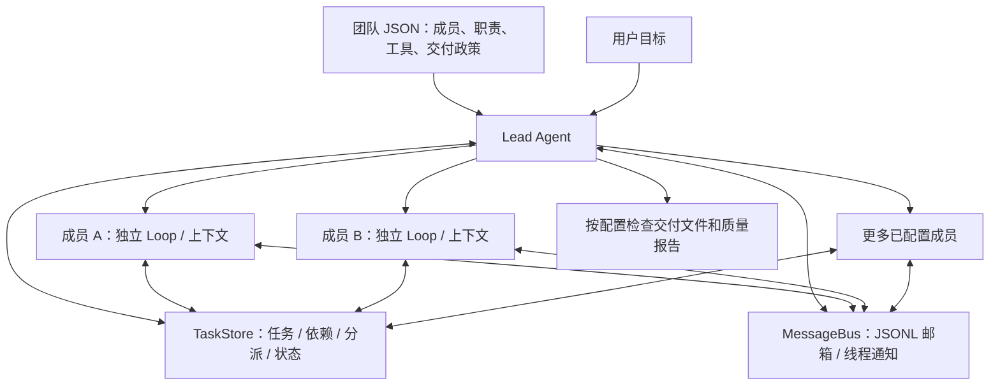

# Configurable Multi-Agent Team Framework

一个可配置的多 Agent 团队框架原型。用户提出目标，Lead 理解需求、拆解任务、创建成员、协调反馈并检查交付。成员通过共享文件任务板与 MessageBus 协作，各自保留独立的 Agent Loop 和消息历史。

核心实现仍集中在带中文注释的 [`main.py`](main.py)。团队名称、成员数量、身份、职责、工作区工具和交付条件由 JSON 配置决定。游戏开发是其中一个示例，也可以配置成调研写作团队或其他工作团队。

> 当前已实现自动上下文压缩；持久 Memory 和 MCP 尚未实现。框架不是操作系统沙箱，产物质量与报告真实性需要实际核验。

## 架构



模型仍通过原来的循环调用 Python 工具：

```text
用户输入 / 团队事件
  → 压缩预算检查
  → client.messages.create
  → tool_use → 执行工具 → tool_result
  → 下一次请求，直到本轮结束
```

Lead 按需启动配置中的成员，并非每次启动所有人。成员 `name` 是任务与邮箱身份；`role` 是职责标签，两者可以不同，多个成员可以使用相同 role。

## 快速开始

需要 Python 3.10+ 和可用的 DeepSeek API 密钥及额度。下面使用 Windows PowerShell：

```powershell
# 仓库地址暂沿用原项目名称；本地已有项目也无需改名
git clone https://github.com/hihihiddssa/game-company-agent.git
cd game-company-agent
# 先激活你自己选择的 Python 环境（venv、Conda 等）
python -m pip install -r requirements.txt
Copy-Item .env.example .env
```

在 `.env` 中填写：

```dotenv
DEEPSEEK_API_KEY=your_deepseek_api_key
MODEL_ID=deepseek-flash
```

实际请求发往 `https://api.deepseek.com/anthropic`，通过 Anthropic SDK 使用兼容消息协议，关闭深度思考。真实 `.env` 已被 Git 忽略。

```powershell
python main.py --check-config
python main.py
```

出现 `team >>` 后输入需求。输入 `q` / `exit`，或按 `Ctrl+C` 退出。`--check-api` 只读模型列表验证接口，不生成文本。

运行环境由你自己选择，项目不指定 Python 路径，也不自动切换环境。

- **终端**：先激活你选择的 venv / Conda 环境，再运行 `python main.py`。`python -m pip install -r requirements.txt` 会将依赖安装到这个环境。
- **VS Code**：按 `Ctrl+Shift+P`，执行 `Python: Select Interpreter`，选择你想用的环境。运行按钮和调试使用这个解释器；已有终端可关闭后重新打开以激活新选择的环境。

可以运行 `python -c "import sys; print(sys.executable)"`，确认当前终端实际使用的解释器。`.env` 保存 API 密钥和应用参数，与 Python 虚拟环境是两回事。

## 切换团队

```powershell
# 默认通用团队：planner、builder、reviewer
python main.py

# 保留原游戏公司的使用方式，建议为新团队选择独立工作区
python main.py --team-config examples/game-team.json --workdir workspace/game-project

# 调研写作：analyst、writer、editor
python main.py --team-config examples/research-team.json --workdir workspace/research-project
```

配置优先级：`--team-config` → `.env` 中 `TEAM_CONFIG` → 项目 `team.json`。未指定配置且默认文件不存在时，使用内置通用团队；显式指定的文件找不到时会报错。运行中的团队不支持热切换配置。

调研示例只包含本地文件工具，没有联网搜索或 MCP 工具。业务运行所需的 Node.js、浏览器等也由具体任务决定，不由 Python 依赖自动提供。

### 配置格式

```json
{
  "name": "Document Team",
  "lead_prompt": "组织成员完成用户的文档任务，使用中文沟通。",
  "members": [
    {
      "name": "author",
      "role": "writer",
      "instructions": "将报告写入 reports/final.md，并注明依据与限制。",
      "tools": ["read_file", "write_file", "edit_file", "glob"]
    },
    {
      "name": "editor",
      "role": "reviewer",
      "instructions": "只读取文件检查并反馈问题。",
      "tools": ["read_file", "glob"]
    }
  ],
  "delivery": {
    "required_members": ["author", "editor"],
    "required_files": ["reports/final.md"],
    "report_path": null,
    "report_owner": null
  }
}
```

`members` 支持 1～32 名成员，名字不能重复或使用保留名 `lead` / `agent`。`instructions` 是职责说明；`tools` 控制工作区工具，省略时开放全部五种基础工具，空列表表示不开放工作区工具。

任务认领、完成、消息和计划提交工具始终保留。工具声明和实际处理函数同时按配置过滤；配置只读成员不会拥有 `write_file`、`edit_file` 或 `bash` 处理函数。允许 `bash` 的成员仍可用 Shell 修改文件，因此该配置不是 OS 级权限隔离。

`delivery` 可以省略，默认没有固定成员和固定文件要求，也不强制质量报告。`accept_delivery(artifacts=[...])` 始终要求所有任务完成，且至少有一个真实产物文件。

### 可选质量报告

设置 `report_path` 时必须指定 `report_owner`，例如：

```json
"delivery": {
  "required_members": ["builder", "reviewer"],
  "required_files": ["docs/result.md"],
  "report_path": "reports/qa.json",
  "report_owner": "reviewer"
}
```

报告引用该成员拥有且完成的任务，结构如下：

```json
{
  "task_id": "实际生成的复核任务ID",
  "passed": true,
  "issues": [],
  "checks": [
    {"name": "检查名称", "command": "实际执行的命令", "returncode": 0, "output": "结果文本"}
  ]
}
```

框架检查报告字段、任务归属、检查退出码和未解决问题；兼容旧游戏报告的 `bugs` 字段。报告路径来自配置，不能在工具参数中换一个路径绕过政策。文件存在和结构通过不代表内容一定正确，也不证明报告中的命令确实被执行。

## 工具分层与阅读入口

| 集合 | 用途 |
| --- | --- |
| `BASE_TOOLS` | Shell、文件读写编辑、文件匹配 |
| `TASK_TOOLS` | 创建、依赖、认领、完成与 `assign_task` |
| `TEAM_TOOLS` | 创建成员、消息、计划审批和关闭 |
| `DELIVERY_TOOLS` | 根据配置执行 `accept_delivery` |

`STUDIO_TOOLS` 和 `accept_game` 已由通用任务/交付工具替代。成员可见工具由 `teammate_tools()` 根据配置生成；Lead 使用 `TOOLS`。验收规则扩展在 `run_accept_delivery()` 中完成。

建议先读 `main()` → `load_team_config()` / `configure_team()` → `agent_loop()` → `TeammateRuntime`，再读 TaskStore、MessageBus 和工具处理函数。相对原教学代码的位置见 [`SOURCE_MAP.md`](SOURCE_MAP.md)。

## 上下文压缩与参数

每次模型请求前调用 `context_manager.prepare()`。超出触发线时，先缩短旧的 `read_file` / `bash` / `glob` 大段输出；仍高于压缩目标时，对旧历史进行滚动摘要。

保留第一条需求、最近消息及完整的工具调用/结果配对。操作先在副本中进行，摘要失败或最终超过总预算时不替换原历史。摘要仅存在当前进程，任务和文件状态仍以任务板和工作区为准。

新的默认值是本框架的调优起点，不是模型官方上下文限制，也不能保证适合所有任务：

| 变量 | 原默认值 | 新默认值 | 原因 |
| --- | --- | --- | --- |
| `CONTEXT_MAX_TOKENS` | 32000 | 48000 | 给协作历史和工具定义更多空间 |
| `CONTEXT_TRIGGER_RATIO` | 无，达到总预算才处理 | 0.8 | 提前触发，默认估算总请求超过 38400 时处理 |
| `CONTEXT_TARGET_RATIO` | 无 | 0.55 | 目标降到约 26400，留出后续增长空间 |
| `CONTEXT_KEEP_RECENT` | 6 | 8 | 多保留最近工作细节，遇到完整调用链可保留更多 |
| `CONTEXT_KEEP_TOOL_RESULTS` | 3 | 3 | 最近的工具结果保持完整 |
| `CONTEXT_SUMMARY_TOKENS` | 1200 | 2000 | 为任务 ID、约束、路径和下一步留更多摘要空间 |
| `CONTEXT_TOOL_RESULT_CHARS` | 写死头尾各 1000 | 2400 | 旧输出保留文本长度可配置，另外附省略提示 |
| `AGENT_MAX_OUTPUT_TOKENS` | 写死 8000 | 4096 | 实际回复上限与压缩预算统一，避免预留两处不一致 |

在 `.env` 中覆盖上述变量，重启生效。`CONTEXT_COMPRESSION_ENABLED=false` 可关闭压缩。总预算包括 system、工具定义、消息、回复预留及余量；按 UTF-8 字节数 / 3 估算，服务端实际 token 计数可能不同。

单次需要输出较长代码或文档时，可把 `AGENT_MAX_OUTPUT_TOKENS` 调到 `8192`；回复预留会同步增加。原 `.env` 中等于旧默认值的 32000 / 6 / 1200 在本次升级时会迁移到新默认值，其他已有自定义值保留。

目标比例是期望值，保留最近历史优先，压缩后可能高于目标。原始需求、近期工具结果或 system 本身太大时会明确报错，需要增加预算或缩小输入。模型摘要会增加 API 请求且可能遗漏细节；较大的预算也会增加普通请求的输入成本。

阅读顺序仍为 `prepare()` → `_micro_compact()` → `_find_cut()` → `_summarize()`。每个 Agent 压缩自己的历史，共享的对象只保存配置。

## 文件和运行状态

```text
main.py                       # 唯一核心 Python 文件
team.json                     # 默认通用团队
examples/game-team.json        # 游戏团队示例
examples/research-team.json    # 本地调研写作团队示例
.env.example                  # 密钥与运行参数模板
workspace/                    # 按需创建，不上传 Git
  .tasks/                     # 共享任务记录
  .mailboxes/                 # JSONL 消息邮箱
  delivery.json               # 通用交付记录
  ...                         # 配置与任务决定的其他产物
```

`.env`、`workspace/`、本地归档 `test/` 和依赖缓存不上传。使用 `--workdir` 或 `TEAM_WORKDIR` 指定独立目录；原 `GAME_STUDIO_WORKDIR` 仍作为兼容项保留。切换团队时建议换工作目录，旧任务不会自动迁移到新成员表。

任务与邮箱落盘，但聊天历史、摘要和线程不会在重启后自动恢复。Shell 默认非交互，报告等待进度并在超时后尝试终止进程树。现阶段建议在专用目录运行并检查 Agent 命令。

## 后续计划与许可

- [x] 可配置成员、职责、工作区工具和交付政策。
- [x] 通用任务派发、共享任务板、MessageBus 与独立 Agent Loop。
- [x] 自动上下文压缩与可调预算。
- [ ] 持久 Memory。
- [ ] MCP Server 接入。

改编自 **learn-claude-code s13** 的团队结构，参考 s08 的压缩思路；原项目 MIT 许可保留在 [`LICENSE`](LICENSE) 中。模型请求使用 [DeepSeek Anthropic 兼容接口](https://api-docs.deepseek.com/guides/anthropic_api/)。
